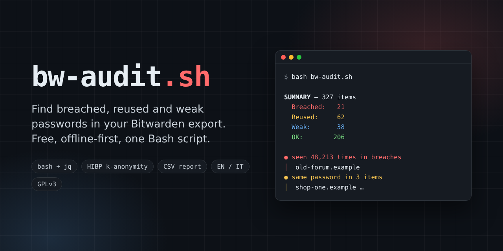
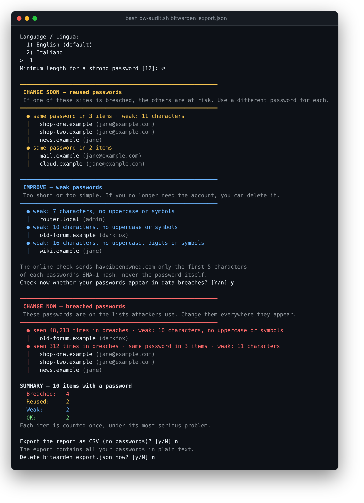

# bw-audit.sh

Find **breached**, **reused** and **weak** passwords in your Bitwarden vault — for free, from the terminal, with a single Bash script.

Bitwarden's free plan tells you *how many* passwords are at risk, but not *which ones*. `bw-audit.sh` reads an unencrypted JSON export of your vault and tells you exactly which items to fix, in order of urgency.



## Features

- **Reused passwords** — items that share the same password, grouped together.
- **Weak passwords** — too short, or missing character types (and it tells you which ones: *"no uppercase or symbols"*).
- **Breached passwords** — checked against [Have I Been Pwned](https://haveibeenpwned.com/Passwords) using k-anonymity. The online check runs **last** and only if you confirm it.
- **Clear report** — color-coded sections: *Change soon* (reused), *Improve* (weak) and, after the online check, *Change now* (breached). The final summary counts each item once, under its most serious problem.
- **CSV export** — optional, without passwords, to tick items off in a spreadsheet.
- **Cleanup** — offers to securely delete the export when you are done.
- **Interactive** — no flags to remember. The interface is available in English and Italian.
- **Passwords are never printed or saved.** Only `.login.password` is read: password history is ignored.

## Privacy: what is sent online

Nothing, unless you say yes to the breach check. If you do, for each distinct password the script:

1. computes the SHA-1 hash **locally**, e.g. `CBFDAC6008F9CAB4083784CBD1874F76618D2A97`;
2. sends only the **first 5 characters** (`CBFDA`) to `api.pwnedpasswords.com`;
3. receives all known breached hashes starting with that prefix (hundreds of them, plus random padding);
4. compares the rest of the hash **locally**.

Neither your password nor its full hash ever leaves your computer. This is the same [k-anonymity model](https://blog.cloudflare.com/validating-leaked-passwords-with-k-anonymity/) used by Bitwarden and 1Password.

There is a single network call in the script: look for `curl`.

## Requirements

- Bash **4+** (on macOS, install it with `brew install bash`; the system Bash 3.2 is too old)
- [`jq`](https://jqlang.github.io/jq/)
- `curl` (only for the breach check)
- `sha1sum` or `shasum`, `base64` (preinstalled almost everywhere)

Tested on Linux and Termux. It should also work on WSL and on macOS with Homebrew Bash, but these have not been tested yet.

## Usage

1. **Export your vault** from Bitwarden: *Tools → Export vault*, format **`.json`** (not *.json (Encrypted)*). If you pick an encrypted export by mistake, the script recognizes it and stops.
2. **Download and run** the script in the same folder:

   ```bash
   curl -fsSLO https://raw.githubusercontent.com/SalvatoreNoschese/bw-audit.sh/main/bw-audit.sh && bash bw-audit.sh
   ```

   It uses the only `.json` in the folder, or lets you pick one. You can also pass the file: `bash bw-audit.sh bitwarden_export.json`.

3. **Answer the questions**: language, minimum length, breach check, CSV export, deletion of the export.

Optional: skip the language menu with `--lang en` or `--lang it`.

## How passwords are rated

| Problem | Rule |
|---|---|
| **Breached** | Found in Have I Been Pwned |
| **Reused** | Same password in two or more items |
| **Weak** | Shorter than the minimum length (default 12), **or** shorter than 20 characters and using fewer than 3 of 4 types (lowercase, uppercase, digits, symbols) |

Only login items with a password are counted. The numbers may differ from Bitwarden's own reports, which use a different strength estimator.

## Security notes

- The export contains **all your passwords in plain text**. Delete it as soon as you are done: the script offers to do it with `shred`. On SSDs and flash storage `shred` cannot guarantee the data is gone, so keep the export on an encrypted disk if you can.
- The CSV report contains no passwords, but it does contain usernames and sites: do not share it.
- Read the script before running it. It is a single, commented file.

## License

[GPL-3.0](LICENSE)

Not affiliated with Bitwarden Inc. or Have I Been Pwned.
